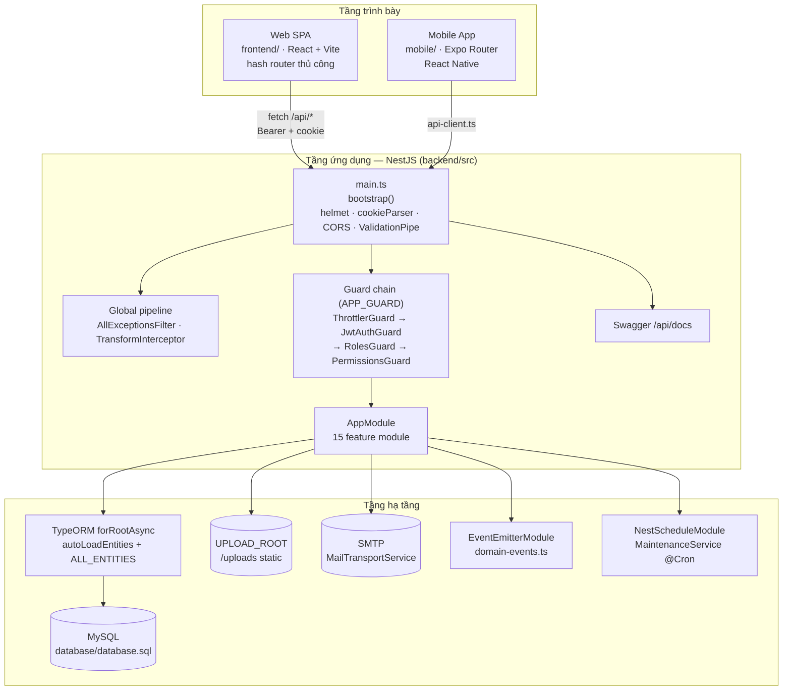
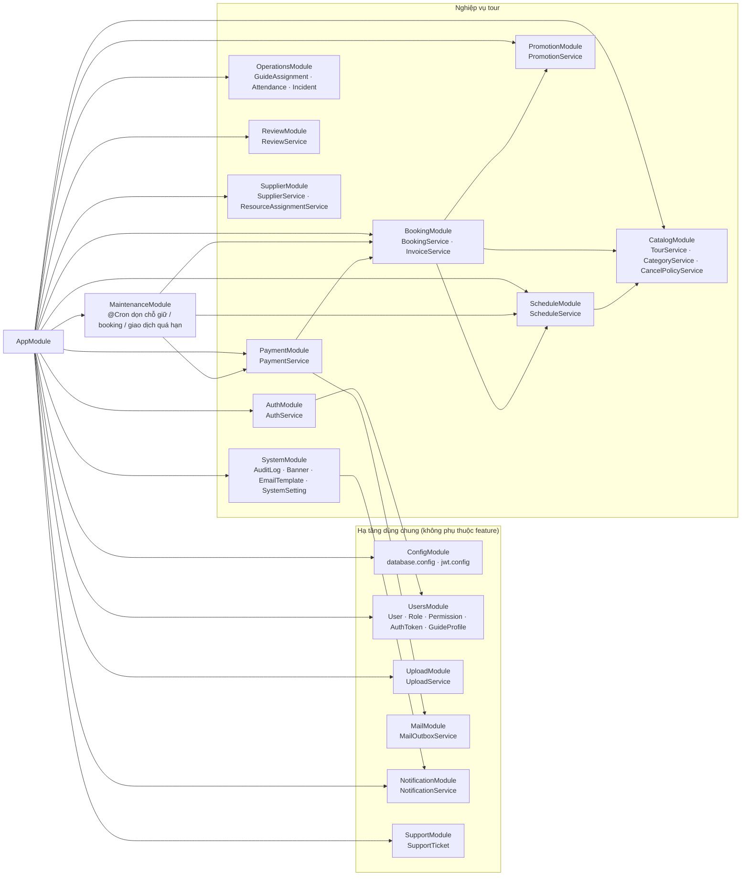
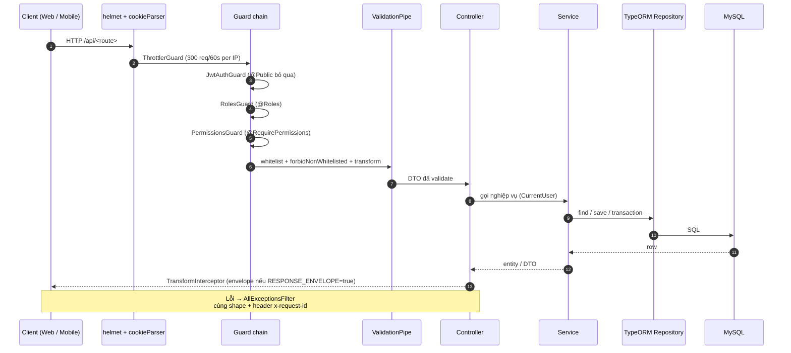
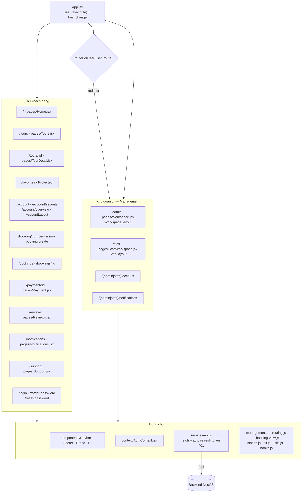
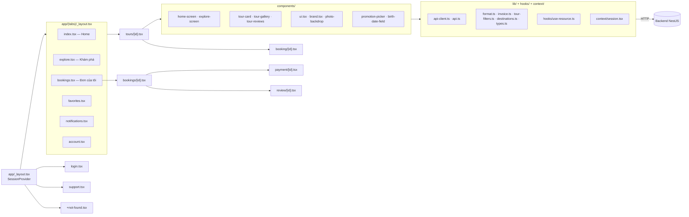

# Sơ đồ cấu trúc hệ thống — DoAnCNPM

> Tài liệu được tổng hợp từ knowledge graph do **graphify** trích xuất bằng AST trên toàn bộ mã nguồn
> (`backend/`, `frontend/`, `mobile/`, `docs/`, `database/`).
>
> **Số liệu graph:** 3.216 node · 9.657 cạnh · 140 community · 97% cạnh `EXTRACTED`, 3% `INFERRED`.
>
> File sinh tự động đi kèm:
> - [`callflow.html`](callflow.html) — 16 sơ đồ Mermaid + 15 bảng call-detail (mở bằng trình duyệt).
> - [`graphify-graph.html`](graphify-graph.html) — đồ thị tương tác, zoom/pan/lọc theo file.

---

## 1. Kiến trúc tổng thể (monorepo 3 tầng client)



---

## 2. Sơ đồ phụ thuộc giữa các module backend

Trích từ `imports:` trong từng `*.module.ts` (16 module). Mũi tên = module bên trái `imports` module bên phải.



**Thứ tự nạp trong `AppModule.imports`** (có chủ đích, tránh vòng lặp):

```
Users → Support → Auth → Catalog → Schedule → Promotion → Booking
→ Payment → Operations → Review → Notification → Supplier → System
→ Upload → Maintenance
```

Quy ước phụ thuộc một chiều: **Catalog → Schedule → Booking → Payment**, trong khi
`Operations` chỉ **đọc** `schedule`/`booking` và `Maintenance` chỉ **gọi service** đã export.

---

## 3. Ánh xạ module → controller → service → entity

| Module | Controller (route prefix) | Service export | Nhóm entity chính |
|---|---|---|---|
| `auth` | `auth.controller.ts` → `auth` | `AuthService` | `AuthToken`, dùng lại `User`/`Role`/`Permission` |
| `users` | `users.controller.ts` → `users`<br/>`roles.controller.ts` → `roles` | `UsersService` + `TypeOrmModule` | `User`, `Role`, `Permission`, `AuthToken`, `GuideProfile` |
| `catalog` | `catalog.controller.ts` → `catalog`<br/>`tours.controller.ts` → `tours` | `TourService`, `CategoryService`, `CancelPolicyService` | `Tour`, `TourImage`, `TourDestination`, `ItineraryDay`, `Category`, `Destination`, `Favorite`, `CancelPolicy`, `CancelPolicyRule`, `DepartureSchedule` |
| `schedule` | `schedule.controller.ts` → `schedules` | `ScheduleService` | `DepartureSchedule`, `SeatHold`, `ScheduleCheckpoint` |
| `promotion` | `promotion.controller.ts` → `promotions` | `PromotionService` | `Promotion` |
| `booking` | `booking.controller.ts` → `bookings` | `BookingService`, `InvoiceService` | `Booking`, `Passenger`, `CancelRequest`, `Invoice`, `DepartureSchedule` |
| `payment` | `payment.controller.ts` → `payments` | `PaymentService` | `Payment`, `PaymentEvent`, `Refund`, `Booking`, `CancelRequest` |
| `operations` | `operations.controller.ts` → `operations`<br/>`attendance.controller.ts` → `operations/attendance`<br/>`guide-assignment.controller.ts` → `operations/assignments`<br/>`incident.controller.ts` → `operations/incidents` | `GuideAssignmentService`, `AttendanceService`, `IncidentService`, `OperationsService` | `GuideAssignment`, `Attendance`, `Incident`, `DepartureSchedule`, `ScheduleCheckpoint`, `Booking`, `Passenger`, `GuideProfile` |
| `review` | `review.controller.ts` → `reviews` | `ReviewService` | `Review`, `Booking`, `Tour`, `DepartureSchedule` |
| `notification` | `notification.controller.ts` → `notifications` | `NotificationService` | `Notification` |
| `supplier` | `supplier.controller.ts` → `suppliers`<br/>`resource-assignment.controller.ts` → `suppliers/resources` | `SupplierService`, `ResourceAssignmentService` | `Supplier`, `ResourceAssignment`, `DepartureSchedule` |
| `system` | `system-setting.controller.ts` → `system/settings`<br/>`audit-log.controller.ts` → `system/audit-logs`<br/>`email-template.controller.ts` → `system/email-templates`<br/>`banner.controller.ts` → `banners`<br/>`report.controller.ts` → `reports` | `AuditLogService`, `BannerService`, `EmailTemplateService`, `SystemSettingService` | `AuditLog`, `Banner`, `EmailTemplate`, `SystemSetting`, `User`, `Booking`, `Tour`, `Payment`, `Refund` |
| `upload` | `upload.controller.ts` → `uploads` | `UploadService` | — (ghi tệp vào `UPLOAD_ROOT`) |
| `support` | `support.controller.ts` → `support` | `SupportService` *(không export)* | `SupportTicket` |
| `mail` | — *(nội bộ)* | `MailOutboxService` | `MailMessage` |
| `maintenance` | — *(chỉ `@Cron`)* | — | dùng lại entity của schedule/booking/payment |

**Tổng đếm:** 16 module · 24 controller · 14 service được export · 38 entity.

---

## 4. Luồng một request đi qua backend



---

## 5. Sơ đồ cấu trúc frontend (Web SPA)

`frontend/src/App.jsx` dùng **hash router tự viết** (`window.location.hash`), không dùng React Router.



**Nhóm trang quản trị theo vai trò** (`docs/ADMIN-WORKSPACE.md`, `docs/STAFF-WORKSPACE.md`):

| Vai trò | Trang | Chức năng |
|---|---|---|
| ADMIN | `AdminDashboard`, `AdminOverview`, `Management`, `Moderation`, `Reports`, `Refunds`, `StaffUsers`, `Banners` | Quản lý tour, danh mục, người dùng, duyệt nội dung, báo cáo, hoàn tiền |
| STAFF | `StaffDashboard`, `StaffBookings`, `StaffPayments`, `StaffSchedules`, `StaffOperations` | Xử lý booking, thu tiền, điều lịch, điểm danh, sự cố |
| CUSTOMER | `Home`, `Tours`, `TourDetail`, `Booking`, `Payment`, `MyBookings`, `Favorites`, `Reviews`, `Support` | Đặt tour, thanh toán, đánh giá, hỗ trợ |

---

## 6. Sơ đồ cấu trúc mobile (Expo Router)



---

## 7. Nhóm entity theo miền nghiệp vụ (38 entity)

```mermaid
flowchart TB
